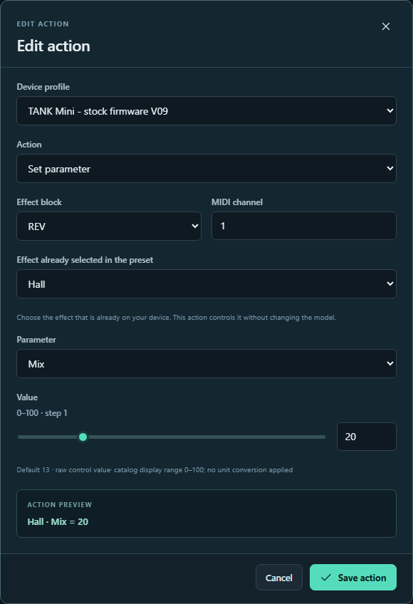
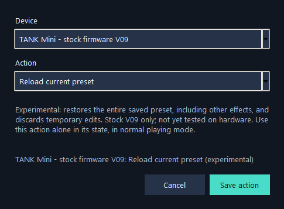

# Stompilot

A visual MIDI configurator for Chocolate Plus on Android and Windows. Use the
built-in TANK Mini profile or enter CC, Program Change and SysEx commands for
other MIDI devices without writing code or installing a profile. Create switch
assignments, edit a local copy of the controller configuration, and apply it
over USB when ready. The app works offline without an account or tracking.

Stompilot is free software under **GPL-3.0-or-later**; see [LICENSE](LICENSE).
Copyright © 2026 Danilo Migliarino and contributors. You may use, study, share
and modify it, including commercially, under that license. Dependencies retain
their own licenses.

## Download and start

Download **Stompilot.apk** from [Releases](https://github.com/danmigdev/stompilot/releases)
for an arm64 Android phone running Android 8 or later. Allow installation from
the app used to open the APK. The release is signed with the certificate whose
SHA-256 fingerprint is in [android/release-signing-certificate.sha256](android/release-signing-certificate.sha256).
If an earlier development APK is installed with a different signing key, export
your projects and profiles before uninstalling it and installing this release.
The official F-Droid submission uses the [build recipe](fdroid/app.stompilot.yml);
catalog availability depends on F-Droid review and publication.

Download **Stompilot.exe** from this repository's **Releases** page
and open it from a writable folder. The portable Windows app includes its Python
runtime, compiled Svelte interface, and USB MIDI dependencies: no Python or Node.js
installation is needed. **Microsoft Edge WebView2 Runtime** is required to display
the interface; if it is missing, install the Evergreen Runtime from
[Microsoft's WebView2 download page](https://developer.microsoft.com/en-us/microsoft-edge/webview2/).
In a source checkout, **Launch Stompilot.cmd** prefers the built
executable.

The built-in TANK profile travels with the executable. Imported profiles are
stored in `profiles/` beside it, and controller backups in `.backups/`. Copy those
folders and `settings.json` when moving existing data. Save project files
wherever you choose.

## Start from a file or a controller

The welcome screen offers **Open saved project**, **Read Chocolate Plus**, and
**Create empty project**. Examples are opened explicitly; startup does not load
or write a configuration automatically.


**Open saved project** loads a Stompilot JSON file. **Read Chocolate Plus** opens
the controller page and scans available MIDI devices. Select the USB device and
choose **Read controller** to see what the controller sends, under **Current
configuration**. A read changes neither the controller nor the open project.
**Chocolate Plus** in the sidebar opens the same page; **Scan devices**
refreshes the device list.


The source banner shows the filename together with the local modification
state. **Save** or **Save project** saves the project to a file; **Save as…**
creates a separate file. Writing requires a controller read, **Preview
changes**, **Write to controller**, and explicit confirmation of that preview.
Reading never writes to the controller.

## Use case: Tremolo and a solo boost

Open [tank_mini_live_boost.json](examples/tank_mini_live_boost.json) with **Open
saved project**. It contains one page with these assignments:

| Switch | State 1 / Bank A | State 2 / Bank B |
| --- | --- | --- |
| A: Tremolo | Tremolo ON | Tremolo OFF |
| B: Solo boost | Boost ON + Hall Reverb Mix 20 + Dual Delay Mix 20 | Reload the current saved preset (experimental) |
| C, D | No messages | — |


Prepare the preset on the TANK: FX = Boost, MOD = Tremolo, REV = Hall, and DLY =
Dual. Reverb and Delay must already be enabled; the solo state changes their Mix
values and does not enable those blocks. Mix 20 is a control value on the 0-100
scale. Save the desired base sound on the TANK before using preset reload. To
return to Boost OFF, save the base preset with FX disabled while leaving Boost
selected as its effect model.

Switch B's first state contains three SysEx messages, totaling 65 bytes. Its
second state contains only the 21-byte reload command. Reload restores **all**
saved states and parameters, including Tremolo, and discards temporary changes.
The saved preset determines the returned Boost, Reverb, and Delay settings; the
second state does not hard-code Boost OFF or Mix 5.


Reload is experimental: its normal-mode stock V09 firmware path was checked
statically, and sent to the TANK over its own USB it restored the saved preset
exactly. Reload through the Chocolate Plus's HOST port is still unverified.
Tuner or other special modes may defer it until normal mode resumes. It does
not save or overwrite a preset. See the [reload protocol evidence](research/tank_preset_reload.md).

## Edit switches and actions

Choose **Add action → Command source → MIDI command** to control a device
without a profile. Give the command an optional name, then choose:

- **Control Change (CC)**: channel 1–16, CC number and value 0–127.
- **Program Change**: channel 1–16 and program number 0–127. Subtract 1 if the
  device's manual labels programs 1–128. Bank Select can be entered as CC 0
  and/or CC 32 before the Program Change, as documented by that device.
- **System Exclusive (SysEx)**: one complete hexadecimal `F0 … F7` message
  with 7-bit data, up to 127 bytes. Include any manufacturer-specific address,
  device ID and checksum required by the device's MIDI documentation.

Commands are stored in the project and shown in the MIDI preview. Each bank
supports up to 16 CC/Program Change rows, or a total of 127 SysEx bytes;
CC/Program Change and SysEx cannot share a bank. Compatibility depends on the
target device's MIDI commands, connection and the Chocolate's forwarding
capabilities. Automatic Live status reading remains specific to TANK Mini.

Select a page and switch A-D, then choose **One sequence** or **Alternate two
states**. Each state has its own ordered action list of effect actions and
device-wide actions:

- **Turn on / off** sets an effect ON or OFF; on the TANK it is SysEx.
- **Toggle on / off (CC)** sends the effect's own CC (TANK: FX 0, AMP 1, MOD 2,
  DLY 3, REV 4, CAB 5), which switches it from whatever state it is in.
- **Set parameter** sets one effect value; on the TANK it is SysEx.
- **Select preset** sends a MIDI Program Change, for example preset 2B on the
  TANK (Program Change 4). The device loads the saved preset, so unsaved
  changes on it are discarded. Any device profile can offer it by listing its
  preset names.
- **Set preset volume** (TANK) sets the volume of the preset that is playing,
  from 0 to 100. Selecting or reloading a preset brings back its saved volume.
- **Reload current preset** (TANK, experimental) restores the saved preset.

The effect chosen in an action must already be selected in the TANK preset;
selecting it in Stompilot does not change the hardware's effect model.

| Effect ON/OFF | Parameter value | Preset reload |
| --- | --- | --- |
|  |  |  |

Review the MIDI preview after editing. Reload must be the only action in its
state. A Program Change is stored as a MIDI row, like a CC, so a state cannot
combine it with SysEx commands such as TANK ON/OFF or preset volume. Required preset settings and verification status remain in the profile
information and the guidance beneath the preview.

## Adjust the interface size

Use **-** and **+** in the top-right **Aa** controls; click the percentage to
reset to 100%. Zoom ranges from 75% to 200% in 25-point steps.
It resizes application text and controls throughout the welcome screen, editor,
action dialogs, controller page, and application confirmations and errors.
Use the scrollbars to reach content in smaller windows at higher zoom.

| Shortcut | Action |
| --- | --- |
| Ctrl + + | Increase zoom |
| Ctrl + - | Decrease zoom |
| Ctrl + 0 | Reset to 100% |
| Ctrl + mouse wheel | Increase or decrease zoom |

Zoom is saved in `settings.json`, separately from projects. Changing zoom does
not mark a project as modified or change MIDI assignments. When Stompilot
closes, it also saves the window's size and position there, and whether it is
maximized. If that position is no longer on a connected screen, the window
opens at its default size. Windows file pickers use their system appearance.


## Read the Chocolate configuration

**Current configuration** lists the working mode, then each active page and
switch with its mode and the commands of each bank. The Chocolate stores MIDI
assignments, not the TANK's current preset values. It also stores only the
bytes of each command, not the device they are for. Stompilot names a command
after an installed device profile only when that profile sends exactly the same
bytes, so each TANK Mini SysEx command appears as its ON/OFF, parameter, model,
or reload action. A TANK command carries a checksummed header, a length, and a
live-patch address, so another manufacturer's SysEx cannot match it by
accident; only a device that uses the same M-VAVE protocol and addresses could
send identical bytes. CC commands are listed by channel, number, and value but
never named, because any device can use the same CC numbers.

A TANK parameter command stores the block and the parameter slot, not the model
selected in the preset. When models differ at that slot, the summary names each
possible parameter, for example `MOD / Depth, Dry or Min = 30 (depends on the
preset's model)`.

The read is for inspection only. To change the controller, open or create a
project and write it. Projects that Stompilot 0.3.3 and earlier imported from
the controller still open: their commands appear as **Imported MIDI** with
their exact bytes, and unchanged banks are written back byte for byte.

## Review and write over USB

1. Open or create the local project to apply. Connect the Chocolate Plus by USB
   and close MidiSuite.
2. In the project editor, choose **Write to Chocolate Plus**. Stompilot opens
   the Chocolate Plus page, reads the controller if it is not connected yet,
   and prepares **Write preview**. With several controllers connected, select
   one, then choose **Read controller** and **Preview changes**. The same steps
   are available from **Chocolate Plus** in the sidebar.
3. Compare **Write preview** with **Current configuration**.
4. Choose **Write to controller**, review the confirmation, then choose **Write
   exact preview** to apply that local project.
5. On the verified original **V13**, wait for **Flash verified**. Set the pedal
   to **O**, unplug USB-C at the pedal and keep its display off for **10 seconds**.
   Return to **U**, reconnect USB-C and select **Verify after restart**. Stompilot
   checks the complete saved configuration and confirms that normal saving is
   active again. Keep the pedal in U and do not press its switches during writing.
   If a save is interrupted, keep it powered and use **Restore backup** first.


Before writing, Stompilot reads the current configuration again and saves an
exact backup beside the app. Stock V13 uses a checked sector erase/program
sequence with direct flash readback and a complete 24-KiB backup. The pending
verification/recovery survives closing and reopening Stompilot. A failed backup,
changed controller configuration, failed acknowledgement, or readback mismatch
stops the operation or reports an error. Other supported firmware versions keep
their existing write path, whose readback verifies RAM rather than permanent storage.
See [write scope and backup details](docs/usage.md#controller-write-scope).

These screenshots show the actual compiled Svelte interface using an isolated,
read-only documentation bridge with simulated controller data. The visible
browser-preview banner identifies that fixture; the desktop app uses its Python
USB bridge. Screenshots do not demonstrate a physical write.

## Device profiles and future devices

**Device profiles** browses profile information, notes, and sources, and imports
or exports JSON definitions. It is not a visual profile-definition editor.
Export a profile, edit the definition in a text editor, then import it with a
new ID and name. TANK Mini stock V09 is the only bundled device profile.


Direct MIDI commands above need no profile. For reusable named CC controls,
adapt the [generic CC profile template](examples/generic_cc_profile.json).
Additional semantic integrations can use a registered Python encoder. JSON profiles are data and
do not execute code. See [profile and encoder details](docs/usage.md#device-profile-extensions).

## Manual MidiSuite workflow

Use the **Copy MIDI bytes** icon beside **Hex bytes** for the selected state, or
**Export MIDI** for a text summary of all assignments. **MIDI rows** displays
the channel, type (CC or Program Change), number, and value of each row. In
MidiSuite, choose the switch, mode, and Bank A/B. Paste all SysEx lines into the
same **SysEx (hex)** field, or add one CC or Program Change row per command,
then save the controller configuration there. Keep every `F0` and
`F7`: the controller sends the field's bytes exactly as stored and does not add
`F0`, although MidiSuite's example hint leaves it out. The exported text is
a human-readable summary, not a native MidiSuite import file.

## Supported scope and verification

- Chocolate Plus USB programming targets firmware 12 to 16 (`FootCtrlPlus_012`
  to `FootCtrlPlus_016`): up to 8 pages, 16 MIDI rows (CC or Program Change)
  per bank, and 127 SysEx bytes per bank. Firmware versions have different save
  implementations; V12 and V13 are distinct builds. The configuration
  layout was mapped on firmware 16 and matches a full read of firmware 13. A
  controller with other firmware can be read, but Stompilot does not write it;
  enter the exported MIDI bytes in MidiSuite instead. Bluetooth configuration
  is not implemented.
- A bank uses MIDI rows or SysEx. Its 128-byte SysEx area starts with a length
  byte, followed by complete SysEx frames, concatenated, which the controller
  sends exactly as stored. Over USB, a `FootCtrlPlus_013` sent three
  consecutive TANK frames from one bank intact, and a Program Change row (type
  0) sent `C0 04`, which loaded TANK preset 2B.
- On one `FootCtrlPlus_013`, configuration corruption was observed across
  U -> H -> U, and was later reproduced in U alone after stock partial writes.
  A proper sector erase/program sequence preserved a test pattern through a
  cold restart and U -> H -> U. Stompilot's new writer uses that method, gated by
  the exact audited stock V13 code hash. It needs 16 unused bytes in an Advanced
  SysEx bank for temporary data; configurations with no suitable padding are
  rejected before mutation. No firmware patch is installed, and the pedal's
  own save routines remain unchanged. See the [investigation](research/chocolate-firmware/README.md).
  The new Stompilot writer also passed a physical V13 pattern-save, cold-start
  and original-restoration test, checking the full 24-KiB configuration at each
  stage. That application test changed inactive padding in one sector; it did
  not repeat the laboratory U -> H -> U cycle.
  The earlier corruption made TANK SysEx commands fail through the HOST port
  while CC and Program Change rows worked.
  [tank_mini_host_cc_pc.json](examples/tank_mini_host_cc_pc.json) uses only
  CC toggles and a Program Change for that case. After an H start, read the
  controller over USB to check that its banks are intact.
- Stompilot v0.3.2 and earlier stored SysEx without the length byte, so the
  controller sent nothing for those banks. Reading such a controller lists the
  affected banks; writing a project that assigns those switches stores them in
  the correct format.
- USB discovery, identity, configuration reading, and writing with full readback
  have been used on physical controllers. Write, backup, and readback failure
  handling is checked with simulated controllers.
- The TANK profile comes from stock V09 firmware analysis. On 2026-10-16,
  `tank_check memory` on a `TANK MINI_009` passed all 842 checks: every ON/OFF,
  each of the 61 models, and the minimum, maximum, and middle of all 250 model
  parameters changed exactly the expected live-patch bytes; the stock CC
  switches flip the same ON/OFF bytes; and Reload current preset restored the
  saved preset. In a listening session the same day, every MOD and FX model and
  parameter was heard, as were DLY Analog, preset volume, and a preset change.
  AMP, CAB, REV, and the other delays were checked by readback only. Sending
  through the HOST port is not yet tested. Parameter display-unit conversions
  are not assumed.

More technical context is in [development and usage notes](docs/usage.md) and the
[Chocolate protocol notes](research/chocolate_protocol.md).

## Check the TANK commands on the device

Connect the TANK Mini to the PC by USB, close other MIDI editors, and run from
the source folder:

```powershell
.\.venv\Scripts\python.exe -m midi_configurator.tank_check show
.\.venv\Scripts\python.exe -m midi_configurator.tank_check memory
.\.venv\Scripts\python.exe -m midi_configurator.tank_check listen mod
.\.venv\Scripts\python.exe -m midi_configurator.tank_check relay
```

- `show` reads the current preset: each block's ON/OFF, model, and values,
  and what differs from the saved preset. An ON/OFF action such as **Tremolo
  ON** turns on whatever model the preset has in that block, so check here
  that MOD is Tremolo.
- `memory` sends every ON/OFF, model, and parameter command of the profile, as
  the exact bytes Stompilot writes to the Chocolate Plus, and reads the TANK's
  memory back after each one. Only the bytes the command names may change.
  Models and parameters are checked with their block off, so test values are
  not heard. It ends with the preset volume, a change to the next preset and
  back (briefly audible), and the reload.
- `listen` turns on each model and alternates each parameter between a quarter
  and three quarters of its range; answer whether you hear it. Name a block
  (`fx`, `amp`, `mod`, `dly`, `rev`, `cab`) and optionally model IDs.
- `relay` needs the Chocolate Plus on USB too (switch on U). It forwards each
  press to the TANK and shows what changed, so it checks the switches as
  written to the controller.

Each check writes only the TANK's live patch, never a saved preset: it compares
the saved presets in RAM and flash before and after, and restores the live
patch when it ends (`relay --keep` keeps the changes). A JSON report goes to
`research/tank-checks/`.

## Android app and live view

The Android app has the same editor as the desktop and a full-screen live view.
The phone is the USB host: a powered USB hub connects the Chocolate Plus (switch
on **U**, its USB jack) and the TANK Mini.

```text
Phone (USB-C) --> powered USB hub --+--> Chocolate Plus (USB jack, switch on U)
                                    +--> TANK Mini
```

The app forwards every footswitch press to the TANK, so the Chocolate never
starts in H mode. **Live** in the menu opens the live view over the whole
screen: the page name at the top and switches A to D below, two by two with the
phone upright and in a row in landscape. Each square shows the switch's label,
what each of its states sends, and the state of the TANK effects it uses. A
press lights its square and marks the state it sent; the page follows the
presses. The X at the top right, or the phone's back button, stops forwarding
and returns to the editor. While the live view is open the screen stays on and
forwarding continues with the screen off.

To use the desktop instead, move the hub's cable from the phone to the PC; a
USB device has one host at a time.

Build a development APK with **Build Android.cmd** (Node.js, JDK 21 and the
Android SDK): it writes `dist\Stompilot.apk` for arm64 phones, Android 8 or
later, signed with the local debug key. Install it by copying it to the phone, or with
`adb install -r dist\Stompilot.apk`.

## Run or build from source

Source development requires Python 3.12 or later, Node.js 20.19 or later, and
Microsoft Edge WebView2 Runtime. **Setup Stompilot.cmd** creates `.venv`, installs
the Python dependencies, and builds the Svelte frontend. **Build Stompilot.cmd**
also installs `requirements-build.txt`, checks and builds the frontend, then
builds `dist/Stompilot.exe` with PyInstaller and `Stompilot.spec`. The packaged
desktop host uses pywebview and WebView2; Node.js is only used while building.

```powershell
python -m venv .venv
.\.venv\Scripts\python.exe -m pip install -r requirements-build.txt
npm.cmd --prefix frontend ci
npm.cmd --prefix frontend run build
.\.venv\Scripts\python.exe midi_configurator/desktop.py
.\.venv\Scripts\python.exe -m PyInstaller --noconfirm --clean Stompilot.spec
```

Offline checks do not write to connected hardware:

```powershell
.\.venv\Scripts\python.exe -m unittest discover -s midi_configurator -t . -v
.\.venv\Scripts\python.exe midi_configurator/desktop.py --check
.\.venv\Scripts\python.exe midi_configurator/desktop.py --smoke-test
npm.cmd --prefix frontend run check
npx.cmd --prefix frontend playwright install chromium
npm.cmd --prefix frontend test
```

The Python suite also includes compiled Svelte/Python service integration tests.
They skip when the frontend build or optional Playwright/Chromium dependencies
are missing. Install `requirements-docs.txt` and the Python Playwright Chromium
browser as described in the [development notes](docs/usage.md#offline-checks) to
include them.

See [screenshot reproduction](docs/usage.md#documentation-screenshots) for the
isolated browser fixture used by this README.

## Automatic releases

Pushing a version tag runs the [Android and Windows release workflow](.github/workflows/release.yml).
It installs dependencies, builds Svelte, runs the Python and browser tests,
packages the EXE, and checks the packaged desktop app before publishing.
It also builds and signs the Android APK after the Android unit tests pass.
The release contains `Stompilot.apk`, `Stompilot.exe`, `tank_mini_live_boost.json`, and
`SHA256SUMS.txt`, with generated release notes and a link to its build results.

After committing and pushing the changes to release:

```powershell
git tag -a v0.4.3 -m "Stompilot v0.4.3"
git push origin v0.4.3
```

Use a new `vMAJOR.MINOR.PATCH` tag for each release. A suffix such as
`v0.4.0-beta.1` publishes a prerelease. Creating a tag locally does not trigger
the workflow until it is pushed. Failed checks prevent publication; inspect
the run under the repository's **Actions** tab. Android releases require the
repository secrets `ANDROID_KEYSTORE_BASE64`, `ANDROID_KEYSTORE_ALIAS`, and
`ANDROID_KEYSTORE_PASSWORD`. The signing key is never stored in Git. Increment
Android's `versionCode` and update `versionName` before each new Android release.

An unsigned Android release can be built on Linux with JDK 21, Node.js 20.19 or
later, Android SDK platform 35 and build tools 35.0.0:

```sh
npm --prefix frontend ci
npm --prefix frontend run build
cd android
./gradlew --no-daemon assembleRelease
```

The APK is `android/app/build/outputs/apk/release/app-release-unsigned.apk`.
The F-Droid recipe builds from the same sources and checks reproducibility
against the signed APK attached to the GitHub release.
