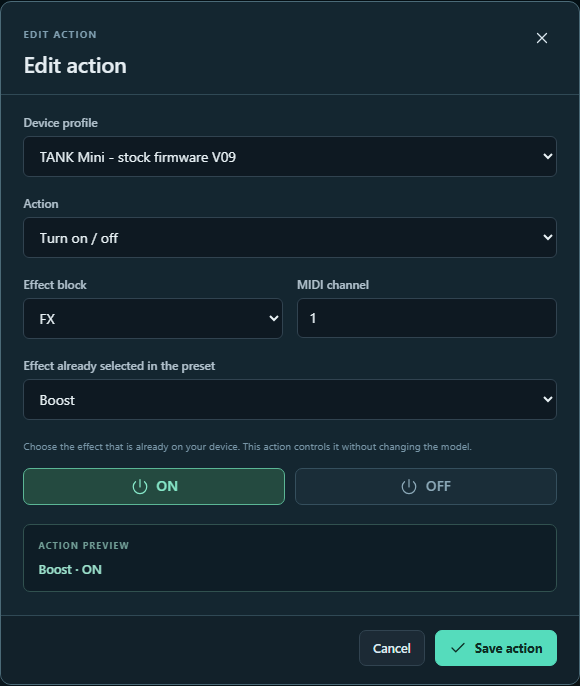
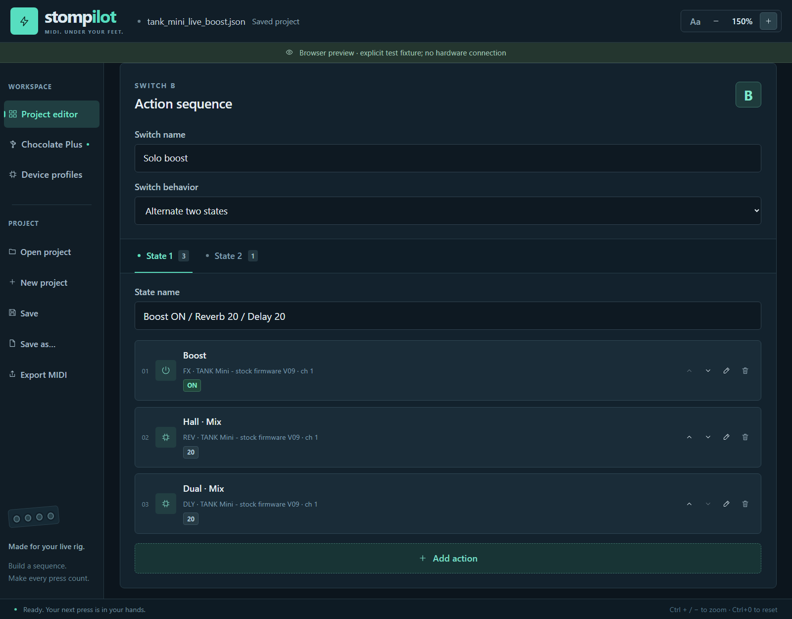
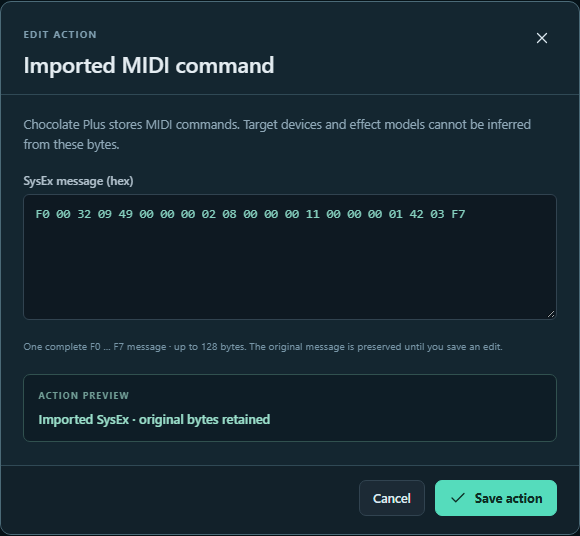
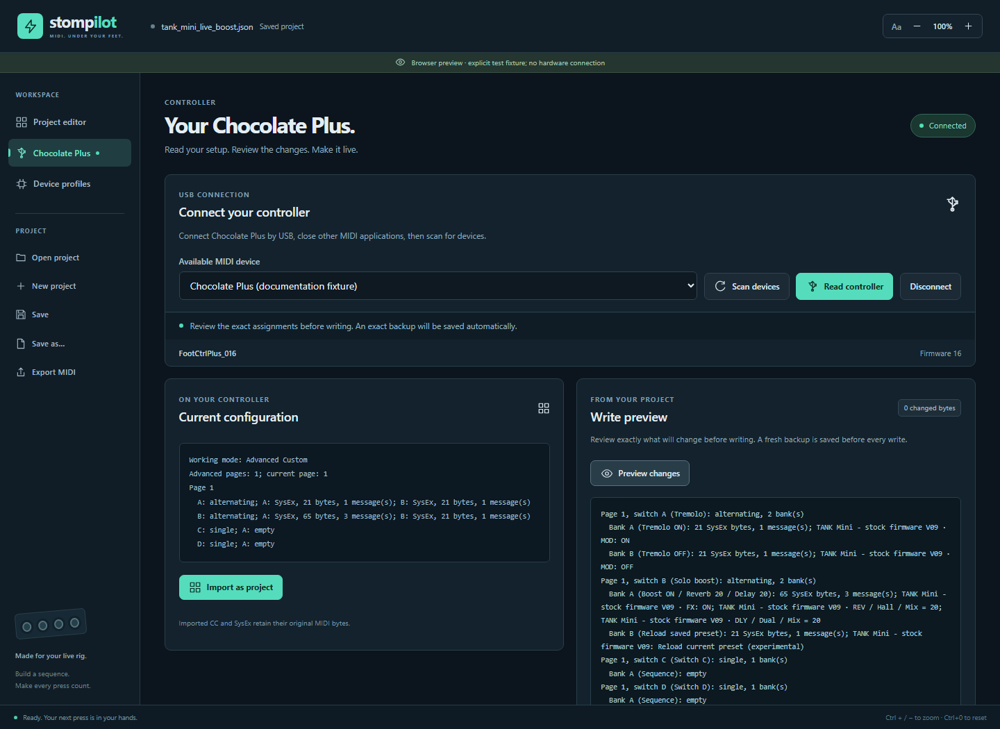
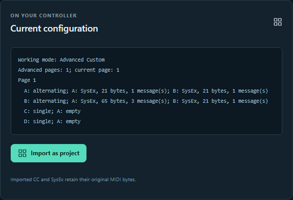
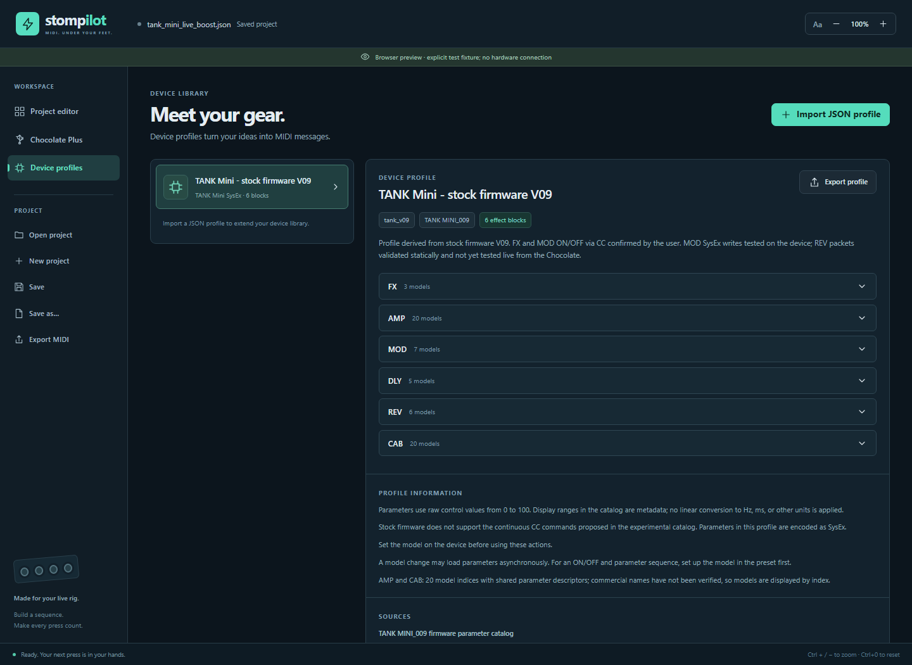

# Stompilot

A visual MIDI configurator for Chocolate Plus, with a built-in TANK Mini profile
and support for future device profiles. Create switch assignments, edit a local
copy of the controller configuration, and apply it over USB when ready. Its
Svelte interface runs in a Windows desktop window backed by a Python MIDI service.

## Download and start

Download [Stompilot.exe from release v0.3.0](https://github.com/danmigdev/stompilot/releases/tag/v0.3.0)
and open it from a writable folder. The portable Windows app includes its Python
runtime, compiled Svelte interface, and USB MIDI dependencies: no Python or Node.js
installation is needed. **Microsoft Edge WebView2 Runtime** is required to display
the interface; if it is missing, install the Evergreen Runtime from
[Microsoft's WebView2 download page](https://developer.microsoft.com/en-us/microsoft-edge/webview2/).
In a source checkout, **Launch Stompilot.cmd** prefers the built
executable.

The built-in TANK profile travels with the executable. Imported profiles are
stored in `profiles/` beside it, and controller backups in `.backups/`. Copy those
folders and `settings.json` when moving existing data. Save project files
wherever you choose.

## Start from a file or a controller

The welcome screen offers **Open saved project**, **Read Chocolate Plus**, and
**Create empty project**. Examples are opened explicitly; startup does not load
or write a configuration automatically.


**Open saved project** loads a Stompilot JSON file. **Read Chocolate Plus** opens
the controller page and scans available MIDI devices. Select the USB device,
choose **Read controller**, inspect **Current configuration**, then choose
**Import as project** for an editable local copy. **Chocolate Plus** in the
sidebar opens the same workflow; **Scan devices** refreshes the device list.


The source banner shows the filename or controller read time, together with the
local modification state. **Save** or **Save project** saves that local copy to
a file; **Save as…** creates a separate file. Writing requires a controller read,
**Preview changes**, **Write to controller**, and explicit confirmation of that
preview. Reading and importing never write to the controller.

The Chocolate stores MIDI assignments, not the TANK's current preset values.
Stompilot preserves imported MIDI bytes without guessing a device, effect, or
model. Firmware 16 Advanced Custom configurations with single or alternating
switches and CC or complete SysEx messages can be imported. Unsupported active
modes, gestures, or command types remain available for read-only inspection and
cannot be imported as an editable project.

## Use case: Tremolo and a solo boost

Open [tank_mini_live_boost.json](examples/tank_mini_live_boost.json) with **Open
saved project**. It contains one page with these assignments:

| Switch | State 1 / Bank A | State 2 / Bank B |
| --- | --- | --- |
| A: Tremolo | Tremolo ON | Tremolo OFF |
| B: Solo boost | Boost ON + Hall Reverb Mix 20 + Dual Delay Mix 20 | Reload the current saved preset (experimental) |
| C, D | No messages | — |


Prepare the preset on the TANK: FX = Boost, MOD = Tremolo, REV = Hall, and DLY =
Dual. Reverb and Delay must already be enabled; the solo state changes their Mix
values and does not enable those blocks. Mix 20 is a control value on the 0-100
scale. Save the desired base sound on the TANK before using preset reload. To
return to Boost OFF, save the base preset with FX disabled while leaving Boost
selected as its effect model.

Switch B's first state contains three SysEx messages, totaling 65 bytes. Its
second state contains only the 21-byte reload command. Reload restores **all**
saved states and parameters, including Tremolo, and discards temporary changes.
The saved preset determines the returned Boost, Reverb, and Delay settings; the
second state does not hard-code Boost OFF or Mix 5.


Reload is experimental: its normal-mode stock V09 firmware path was checked
statically, but physical reload through the Chocolate Plus is still unverified.
Tuner or other special modes may defer it until normal mode resumes. It does
not save or overwrite a preset. See the [reload protocol evidence](research/tank_preset_reload.md).

## Edit switches and actions

Select a page and switch A-D, then choose **One sequence** or **Alternate two
states**. Each state has its own ordered action list. Add or edit an ON/OFF
action, an effect parameter, or the device-wide **Reload current preset** action.
The effect chosen in an action must already be selected in the TANK preset;
selecting it in Stompilot does not change the hardware's effect model.

| Effect ON/OFF | Parameter value | Preset reload |
| --- | --- | --- |
|  |  |  |

Review the MIDI preview after editing. Reload must be the only action in its
state. Required preset settings and verification status remain in the profile
information and the guidance beneath the preview.

## Adjust the interface size

Use **-** and **+** in the top-right **Aa** controls; click the percentage to
reset to 100%. Zoom ranges from 75% to 200% in 25-point steps.
It resizes application text and controls throughout the welcome screen, editor,
action dialogs, controller page, and application confirmations and errors.
Use the scrollbars to reach content in smaller windows at higher zoom.

| Shortcut | Action |
| --- | --- |
| Ctrl + + | Increase zoom |
| Ctrl + - | Decrease zoom |
| Ctrl + 0 | Reset to 100% |
| Ctrl + mouse wheel | Increase or decrease zoom |

Zoom is saved in `settings.json`, separately from projects. Changing zoom does
not mark a project as modified or change MIDI assignments. Windows file pickers
use their system appearance.



## Edit assignments read from the Chocolate

Imported assignments appear as **Imported MIDI**. Their exact commands remain
available even when no matching device profile exists.


A CC command can be edited by channel, controller number, and value. A SysEx
command uses a hexadecimal editor, with complete-frame and 7-bit validation.
These editors preserve raw commands rather than labeling them as a particular
TANK effect.

| Imported CC | Imported SysEx |
| --- | --- |
|  |  |

## Review and write over USB

1. Open or create the local project to apply. Connect the Chocolate Plus by USB
   and close MidiSuite.
2. Open **Chocolate Plus** in the sidebar, choose **Scan devices**, select the
   device, and choose **Read controller**.
3. Choose **Preview changes** and compare **Write preview** with **Current
   configuration**.
4. Choose **Write to controller**, review the confirmation, then choose **Write
   exact preview** to apply that local project.





Before writing, Stompilot reads the current configuration again and saves an
exact backup beside the app. It writes changed bytes and reads the result back
to verify it. A failed backup, changed controller configuration, failed
acknowledgement, or readback mismatch stops the operation or reports an error.
See [write scope and backup details](docs/usage.md#controller-write-scope).

These screenshots show the actual compiled Svelte interface using an isolated,
read-only documentation bridge with simulated controller data. The visible
browser-preview banner identifies that fixture; the desktop app uses its Python
USB bridge. Screenshots do not demonstrate a physical write.

## Device profiles and future devices

**Device profiles** browses profile information, notes, and sources, and imports
or exports JSON definitions. It is not a visual profile-definition editor.
Export a profile, edit the definition in a text editor, then import it with a
new ID and name. TANK Mini stock V09 is the only bundled device profile.



For another device using CC, adapt the [generic CC profile template](examples/generic_cc_profile.json).
Other protocols can use a registered Python encoder. JSON profiles are data and
do not execute code. See [profile and encoder details](docs/usage.md#device-profile-extensions).

## Manual MidiSuite workflow

Use the **Copy MIDI bytes** icon beside **Hex bytes** for the selected state, or
**Export MIDI** for a text summary of all assignments. **CC rows** displays
channel, controller number, and value. In MidiSuite, choose the switch, mode, and Bank
A/B. Paste all SysEx lines into the same **SysEx (hex)** field, or add one CC row
per command, then save the controller configuration there. The exported text is
a human-readable summary, not a native MidiSuite import file.

## Supported scope and verification

- Chocolate Plus USB programming targets firmware 16 (`FootCtrlPlus_016`): up to
  8 pages, 16 CC rows per bank, and 128 SysEx bytes per bank. Bluetooth
  configuration is not implemented.
- A bank uses CC or SysEx. Multiple complete SysEx frames are concatenated within
  that bank's 128-byte limit; physical forwarding of consecutive frames still
  needs verification.
- USB discovery, identity, and configuration reading have been verified on a
  connected firmware 16 controller. The tested one-page configuration produced
  a zero-change write preview after import. Physical writing remains unverified;
  write, backup, and readback behavior is checked with simulated controllers.
- The TANK profile comes from stock V09 firmware analysis. MOD SysEx has been
  tested on the device; the solo parameter sequence and preset reload still
  need a complete physical test. Parameter display-unit conversions are not
  assumed.

More technical context is in [development and usage notes](docs/usage.md) and the
[Chocolate protocol notes](research/chocolate_protocol.md).

## Run or build from source

Source development requires Python 3.12 or later, Node.js 20.19 or later, and
Microsoft Edge WebView2 Runtime. **Setup Stompilot.cmd** creates `.venv`, installs
the Python dependencies, and builds the Svelte frontend. **Build Stompilot.cmd**
also installs `requirements-build.txt`, checks and builds the frontend, then
builds `dist/Stompilot.exe` with PyInstaller and `Stompilot.spec`. The packaged
desktop host uses pywebview and WebView2; Node.js is only used while building.

```powershell
python -m venv .venv
.\.venv\Scripts\python.exe -m pip install -r requirements-build.txt
npm.cmd --prefix frontend ci
npm.cmd --prefix frontend run build
.\.venv\Scripts\python.exe midi_configurator/desktop.py
.\.venv\Scripts\python.exe -m PyInstaller --noconfirm --clean Stompilot.spec
```

Offline checks do not write to connected hardware:

```powershell
.\.venv\Scripts\python.exe -m unittest discover -s midi_configurator -t . -v
.\.venv\Scripts\python.exe midi_configurator/desktop.py --check
.\.venv\Scripts\python.exe midi_configurator/desktop.py --smoke-test
npm.cmd --prefix frontend run check
npx.cmd --prefix frontend playwright install chromium
npm.cmd --prefix frontend test
```

The Python suite also includes compiled Svelte/Python service integration tests.
They skip when the frontend build or optional Playwright/Chromium dependencies
are missing. Install `requirements-docs.txt` and the Python Playwright Chromium
browser as described in the [development notes](docs/usage.md#offline-checks) to
include them.

See [screenshot reproduction](docs/usage.md#documentation-screenshots) for the
isolated browser fixture used by this README.
